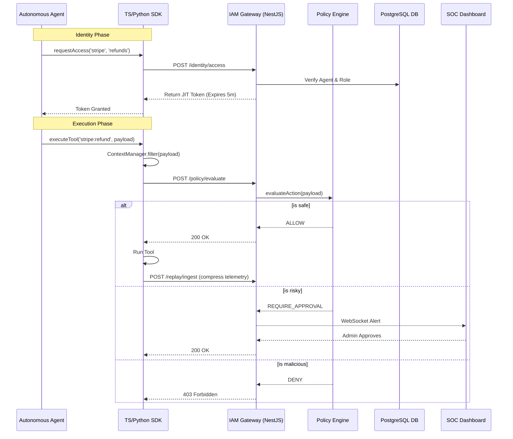

# Architecture

The Agent Runtime Platform is designed to intercept, authorize, and audit every critical action taken by an autonomous agent.

## High-Level Data Flow

## Core Modules

1. **Identity Module (`/identity`)**: Handles the distribution of Just-In-Time (JIT) ephemeral credentials based on strict Role-Based Access Control (RBAC).
2. **Policy Engine (`/policy`)**: Evaluates incoming agent intents against global security rules. Triggers Human-in-the-Loop workflows.
3. **Threat Intel (`/threat-intel`)**: Heuristically scans prompts for jailbreaks and monitors memory mutations for anomalous entropy spikes.
4. **Replay Engine (`/replay`)**: Serves as the "Chrome DevTools for Agents". Compresses and stores telemetry using OpenTelemetry principles (`parentTraceId`) to link distributed multi-agent swarms.
5. **Trust Registry (`/mcp-trust`)**: Validates the cryptographic hashes of external MCP tools to prevent supply chain poisoning.
