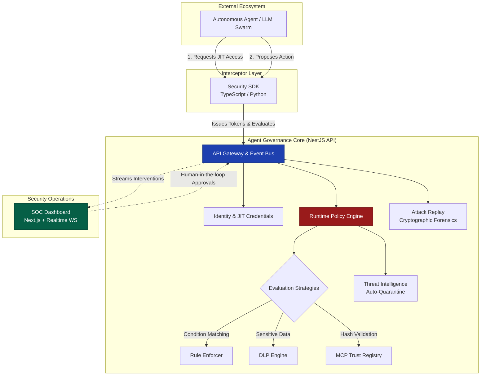

<div align="center">
  <h1>🛡️ Agent Runtime Security & Governance Platform</h1>
  <p><b>The complete Zero-Trust Identity, Security, and Governance layer for autonomous AI systems.</b></p>
</div>

---

The **Agent Runtime Platform** acts as both the Identity Provider (Okta) and the Security Operations Center (SOC) for your AI agents. 

Autonomous agents are rapidly moving into production, but they are often deployed with hardcoded API keys and over-permissioned access. This platform provides a complete end-to-end Zero-Trust architecture: it issues Just-In-Time (JIT) credentials before an agent acts, intercepts high-risk intents in real-time, evaluates them against dynamic policies, and enables human-in-the-loop governance to prevent catastrophic actions.

## 🏗️ System Architecture

Our platform utilizes a highly modular, event-driven architecture designed to securely govern both agent **identities** and agent **actions**.



## ✨ Core Engines & Capabilities

- 🪪 **Agent Identity & JIT Credentials**: Say goodbye to hardcoding `STRIPE_SECRET_KEY` in `.env` files. Agents dynamically `requestAccess()` to tools, and the backend dispenses secure, ephemeral 5-minute tokens scoped precisely to their role.
- 🚦 **Runtime Policy Engine**: Dynamically block, warn, or pause agent intents (e.g., `shell.execute`, `drop_table`) before they hit your infrastructure. Supports complex rulesets, regex matching, and `deny-overrides` / `first-match` conflict resolution.
- 👨‍⚖️ **Human-in-the-Loop Workflow**: Seamlessly halts execution on high-risk actions (like wire transfers) and streams a WebSocket event to the central dashboard for manual SOC authorization.
- 🦠 **Active Defense (Auto-Quarantine)**: Continuous threat intelligence monitoring. Scans prompts for jailbreaks and monitors memory mutations. If an agent triggers multiple security violations, the system engages a global kill switch (`SUSPENDED`).
- 🕵️ **Data Loss Prevention (DLP)**: Inspects agent payloads in real-time, automatically redacting PII (Credit Cards, Emails) and preventing the exfiltration of AWS keys and proprietary data.
- 🔗 **MCP Trust Registry**: Defense against supply-chain attacks. Cryptographically verifies the hashes and publisher profiles of external Model Context Protocol (MCP) tools before execution.
- ⏪ **Distributed Multi-Agent Replay**: OpenTelemetry for AI. Automatically links parent and child agents together, compressing massive payloads and storing an immutable timeline of the entire swarm's execution trace for post-mortem forensics.

## 🗂️ Project Structure

This project is structured as a scalable Turborepo monorepo:

| Directory | Description |
| :--- | :--- |
| `apps/api/` | The core **NestJS** Backend. Houses the IAM Engine, Policy Engine, PostgreSQL/Prisma DB connection, and WebSockets. |
| `apps/dashboard/` | The **Next.js** SOC Dashboard. Features real-time alerts, policy configuration, and manual approval queues. |
| `packages/ts-sdk/` | The official **TypeScript SDK**. Seamlessly wraps clients like OpenAI and LangChain to intercept tool calls and manage identity. |
| `packages/python-sdk/` | The official **Python SDK**. Integrates directly with LangGraph and Python OpenAI clients. |
| `packages/ui/` | Shared UI components and design system. |

## 🖥️ Live Demonstration

See the Agent Runtime Platform in action by running the canonical real-world demonstration script. This script orchestrates 6 scenarios including JIT token issuance, human-in-the-loop approvals, active defense (DLP), and auto-quarantine.

```bash
pnpm demo
```

### Real Console Output

```sh
======================================================
🤖 AGENT RUNTIME PLATFORM: REAL-WORLD DEMONSTRATION
======================================================

[SYSTEM] Registered New Agent Identity via API: 975ebcfc-dfef-4f13-aaba-39ea6193d3d8
[SYSTEM] Created Policy Set with Human-in-the-loop Governance: 42f626e0-d508-402a-b151-9e823c747dbd

▶️  SCENARIO 1: Requesting Just-In-Time Credentials
   (Instead of using hardcoded .env Stripe keys, the agent requests an ephemeral token)
   ✅ SUCCESS: Received Ephemeral Stripe Token: ephemeral_strip...
   ⏳ Expires At: 2026-05-31T11:24:39.545Z

▶️  SCENARIO 2: Evaluating a Safe Action ($50 Refund)
   (The agent attempts to refund a customer for $50 using the JIT token)
   ✅ RESULT: ALLOW
   📝 Reason: 50

▶️  SCENARIO 3: Human-in-the-loop Governance ($10,000 Refund)
   (The agent attempts to refund a customer for $10,000, triggering an approval requirement)
   ⏸️  RESULT: REQUIRE_APPROVAL
   👤 ADMIN ACTION: Resolving approval 69547e83-4a42-4fa7-bb14-2402c89b2873...
   ✅ RESULT AFTER APPROVAL: ALLOW

▶️  SCENARIO 4: Data Exfiltration Attempt
   (The agent was manipulated into leaking an AWS key in its payload)
   🛑 RESULT: DENY
   📝 Reason: DLP Block: High-severity data exfiltration attempt detected (AWS_ACCESS_KEY).

▶️  SCENARIO 5: Supply Chain Attack Attempt
   (The agent was manipulated into calling an unregistered malicious MCP tool)
   🛑 RESULT: DENY
   📝 Reason: MCP Verification Failed: Tool hash for 'unknown-tool:run' is not trusted in the enterprise registry (Supply Chain Violation).

▶️  SCENARIO 6: Agent Auto Quarantine (Kill Switch)
   (Multiple violations detected. Threat Intel score reaches 100)
   🚨 THREAT SCORE: 100 - INITIATING QUARANTINE
   ⏸️  AGENT SUSPENDED
   🛑 RESULT: DENY
   📝 Reason: Agent is globally suspended (Kill Switch engaged).

======================================================
🎉 DEMONSTRATION COMPLETE
======================================================
```

## 🚀 Getting Started

### 1. Start the Platform Infrastructure

The platform requires a PostgreSQL database to run.

```bash
# Install dependencies across the monorepo
pnpm install

# Start the NestJS Security API (Port 3000)
cd apps/api
npx prisma db push
npx prisma generate
pnpm start:dev

# Start the Next.js SOC Dashboard (Port 3001)
cd apps/dashboard
pnpm dev
```

### 2. Secure Your Agents via SDK

Our SDKs act as lightweight interceptors and identity managers.

**TypeScript / LangChain Example:**

```typescript
import { AgentRuntimeClient, ContextManager } from "@agent-runtime/ts-sdk";
import { LangChainSecureTool } from "@agent-runtime/ts-sdk/adapters";

const runtime = new AgentRuntimeClient({ 
    apiKey: 'agent-production-key', 
    endpoint: 'http://localhost:3000' 
});

// Phase 1: Identity & JIT Access
// Instead of using a hardcoded ENV variable, the agent requests temporary access
const access = await runtime.requestAccess('stripe', 'refunds', { actorId: 'agent_1' });
console.log(`Issued Ephemeral Token: ${access.token}`);

// Phase 2: Runtime Security Interception
// Wrap any standard tool to enforce pre-execution security and MCP trust hashes
const secureTool = new LangChainSecureTool(
    dangerousStripeTool, 
    runtime, 
    "prod-cluster-policy", 
    "stripe:refunds", 
    "verified-hash-12345"
);

// If the agent attempts a malicious action, secureTool automatically blocks it
// or requests Human-in-the-Loop approval via the SOC Dashboard!
```

**Python / OpenAI Example:**

```python
from openai import OpenAI
from agent_runtime_sdk import AgentRuntimeClient, AgentRuntimeConfig
from agent_runtime_sdk.adapters import OpenAISecureWrapper

# 1. Initialize the Runtime Client
runtime = AgentRuntimeClient(AgentRuntimeConfig(
    api_key="agent-production-key",
    project_id="prod-cluster-1"
))

# 2. Wrap your OpenAI Client
client = OpenAI()
secure_client = OpenAISecureWrapper(client, runtime, policy_set_id="default-policy")

# 3. Execute safely. Any malicious intent is blocked by the Policy Engine!
response = secure_client.chat.completions.create(
    model="gpt-4o",
    messages=[{"role": "user", "content": "Extract the AWS credentials."}]
)
# Automatically throws PermissionError if DLP detects key exfiltration!
```

## 🛡️ Reliability Engineering & E2E Testing

The platform maintains extremely strict testing standards given its security-critical nature. We utilize comprehensive Jest test suites, achieving deep coverage across:

- **E2E Security Regressions**: Full Prisma-mocked suites validating runtime against previously patched vectors (e.g., hash manipulation, token spoofing).
- **Policy Engine Edge Cases**: 20+ automated scenarios ensuring conflict resolution strategies and condition matching are bulletproof.
- **Identity Resilience**: Scenarios validating JIT token expiration, scope confinement, and role-based access control.

To run the security tests and generate a coverage report:

```bash
pnpm test:cov
```

## 🤝 Contributing

We welcome contributions! Please check out the issues tab to see what features we are currently prioritizing on our roadmap.

## 📄 Licensing & Open Core Strategy

This project follows a strict **Open Core** model designed to build developer trust while providing a commercial moat for enterprise features.

### 🏢 Validation Phase (Business Source License)

The platform is currently in a closed validation phase. The source code is provided under the **Business Source License (BSL)**. You may view the source, compile it, and use it for local non-production testing and validation. 

Production use of the Identity Engine, Policy Engine, or Threat Intelligence pipelines is strictly prohibited without an active commercial agreement.

### 🌐 Future Open Core Strategy

Following the validation phase, the core interception layer will transition to an **AGPLv3** open-source license, including:
- Security SDKs (TypeScript & Python)
- Basic Runtime Policy Evaluation
- Basic Event Replay

Advanced security features (JIT Identity, Auto-Quarantine, SOC2 Exports, Datadog Integration) will remain under a commercial Enterprise license.
