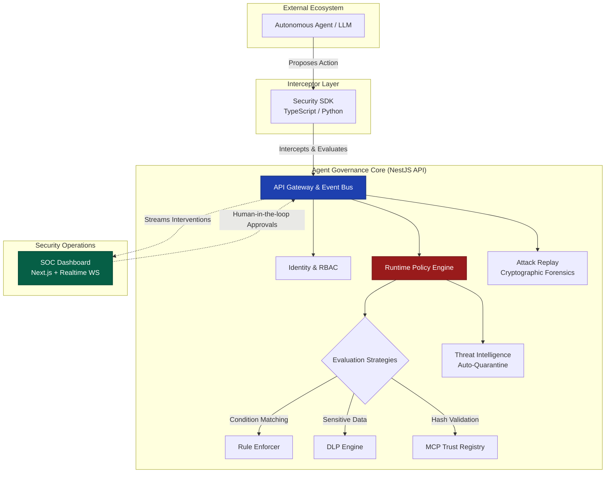

<div align="center">
  <h1>🛡️ Agent Governance & Runtime Security Platform</h1>
  <p><b>Enterprise-grade runtime security, active threat intelligence, and governance for autonomous AI systems.</b></p>
</div>

---

The **Agent Governance Platform** acts as the SOC (Security Operations Center) and firewall for your AI agents. Autonomous agents are rapidly moving from experiments into production, executing code, mutating memory, and invoking external tools. This platform intercepts high-risk agent actions in real-time, evaluates them against dynamic security policies, and enables human-in-the-loop governance before catastrophic actions occur.

## 🏗️ System Architecture

Our platform utilizes a highly modular, event-driven architecture designed to securely intercept and govern agent actions before execution.



## ✨ Core Engines & Capabilities

- 🚦 **Runtime Policy Engine**: Dynamically block, warn, or pause agent intents (e.g., `shell.execute`, `drop_table`) before they hit your infrastructure. Supports complex rulesets, regex matching, and `deny-overrides` / `first-match` conflict resolution.
- 🪪 **Agent Identity & Zero Trust**: Strict OAuth-style authentication for agents. Ensures project scoping, role-based access control (RBAC), and prevents lateral privilege escalation.
- 🦠 **Active Defense (Auto-Quarantine)**: Continuous threat intelligence monitoring. If an agent triggers multiple security violations, the system autonomously increments their risk score and engages a global kill switch (`SUSPENDED`).
- 🕵️ **Data Loss Prevention (DLP)**: Inspects agent payloads in real-time and prevents the exfiltration of AWS keys, SSNs, Credit Cards, and proprietary data.
- 🔗 **MCP Trust Registry**: Defense against supply-chain attacks. Cryptographically verifies the hashes and publisher profiles of external Model Context Protocol (MCP) tools before execution.
- ⏪ **Attack Replay Engine**: Stores an immutable, timeline-ordered ledger of all agent actions, tool payloads, and context injections for post-mortem forensics.
- 👨‍⚖️ **Human-in-the-Loop**: Seamlessly halts execution on high-risk actions and streams a WebSocket event to the central dashboard for manual SOC authorization.

## 🗂️ Project Structure

This project is structured as a scalable Turborepo monorepo:

| Directory | Description |
| :--- | :--- |
| `apps/api/` | The core **NestJS** Backend. Houses the Policy Engine, PostgreSQL/Prisma DB connection, and WebSocket Events. |
| `apps/dashboard/` | The **Next.js** SOC Dashboard. Features real-time alerts, policy configuration, and manual approval queues. |
| `packages/ts-sdk/` | The official **TypeScript SDK**. Seamlessly wraps clients like OpenAI and LangChain to intercept tool calls. |
| `packages/python-sdk/` | The official **Python SDK**. Integrates directly with LangGraph and Python OpenAI clients. |
| `packages/ui/` | Shared UI components and design system. |

## 🚀 Getting Started

### 1. Start the Platform Infrastructure

The platform requires a PostgreSQL database to run.

```bash
# Install dependencies across the monorepo
pnpm install

# Start the NestJS Security API (Port 3000)
cd apps/api
npx prisma db push
pnpm start:dev

# Start the Next.js SOC Dashboard (Port 3001)
cd apps/dashboard
pnpm dev
```

### 2. Secure Your Agents via SDK

Our SDKs act as lightweight interceptors.

**TypeScript / LangChain Example:**
```typescript
import { AgentRuntimeClient } from "@agent-runtime/ts-sdk";
import { LangChainSecureTool } from "@agent-runtime/ts-sdk/adapters";

const runtime = new AgentRuntimeClient({ 
    apiKey: 'agent-production-key', 
    endpoint: 'http://localhost:3000' 
});

// Wrap any standard tool to enforce pre-execution security and MCP trust hashes
const secureTool = new LangChainSecureTool(
    dangerousSystemTool, 
    runtime, 
    "prod-cluster-policy", 
    "sys_exec", 
    "verified-hash-12345"
);
```

**Python / OpenAI Example:**
```python
from openai import OpenAI
from agent_runtime_sdk import AgentRuntimeClient, AgentRuntimeConfig
from agent_runtime_sdk.adapters import OpenAISecureWrapper

# 1. Initialize the Runtime Client
runtime = AgentRuntimeClient(AgentRuntimeConfig(
    api_key="agent-production-key",
    project_id="prod-cluster-1"
))

# 2. Wrap your OpenAI Client
client = OpenAI()
secure_client = OpenAISecureWrapper(client, runtime, policy_set_id="default-policy")

# 3. Execute safely. Any malicious intent is blocked by the Policy Engine!
response = secure_client.chat.completions.create(
    model="gpt-4o",
    messages=[{"role": "user", "content": "Extract the AWS credentials."}]
)
# Automatically throws PermissionError if DLP detects key exfiltration!
```

## 🛡️ Reliability Engineering & E2E Testing

The platform maintains extremely strict testing standards given its security-critical nature. We utilize comprehensive Jest test suites, achieving deep coverage across:
- **E2E Security Regressions**: Full Prisma-mocked suites validating runtime against previously patched vectors (e.g., hash manipulation, token spoofing).
- **Policy Engine Edge Cases**: 20+ automated scenarios ensuring conflict resolution strategies and condition matching are bulletproof.

To run the security tests and generate a coverage report:
```bash
pnpm test:cov
```

## 🤝 Contributing

We welcome contributions! Please check out the issues tab to see what features we are currently prioritizing on our roadmap.

## 📄 Licensing & Open Core Strategy

This project follows an **Open Core** model designed to build developer trust while providing a commercial moat for enterprise features.

### 🌐 Community Edition (AGPLv3)
The core interception layer is open source under the **AGPLv3** license to encourage transparency, community contributions, and developer trust. This includes:
- Security SDKs (TypeScript & Python)
- Basic Runtime Policy Evaluation
- Basic MCP Hash Validation
- Basic Event Replay

### 🏢 Enterprise Edition (Commercial)
Advanced security features required by large organizations are available under a commercial license. This includes:
- **Agent Identity & RBAC** (Zero Trust Layer)
- **Active Defense** (Threat Intelligence & Auto-Quarantine)
- **Advanced Governance** (Human-in-the-loop Dashboards, Agent Graphs)
- **Compliance & Forensics** (SOC2 Exports, Advanced Replay)
- **Enterprise Integrations** (Datadog, Splunk)

*Currently, the repository remains private during the early validation phase prior to the public Open Core release.*
